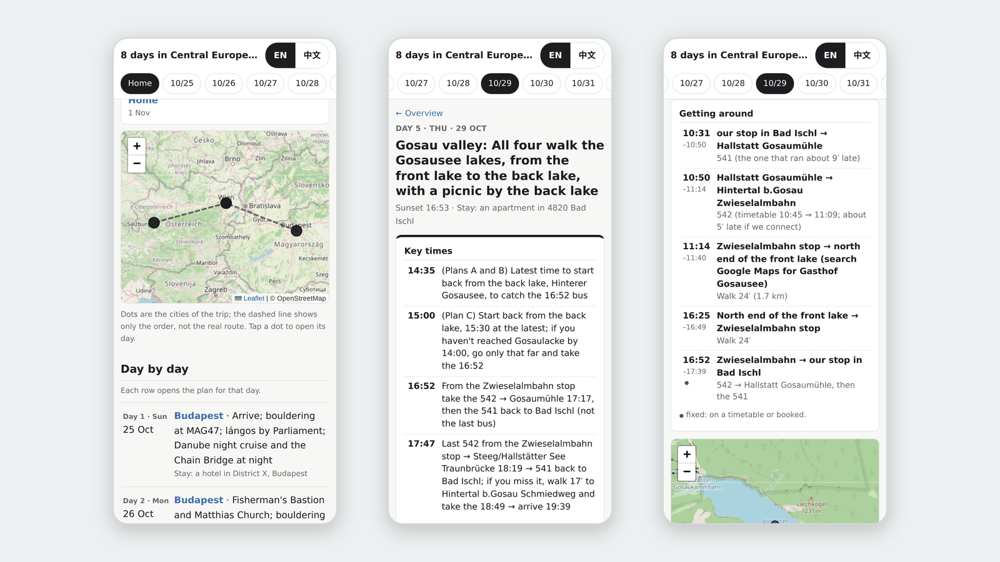
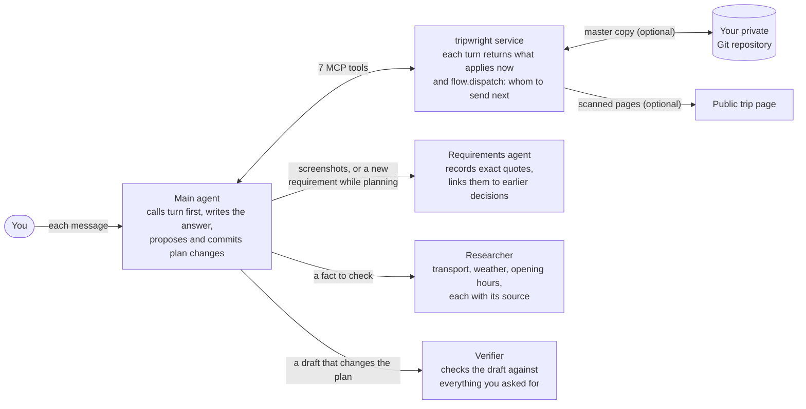
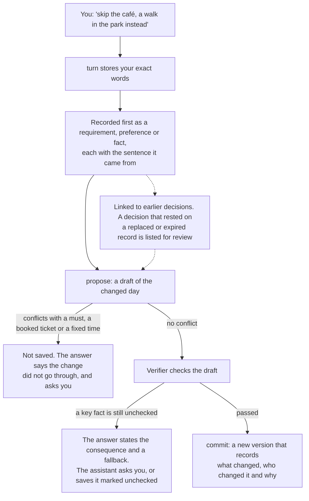
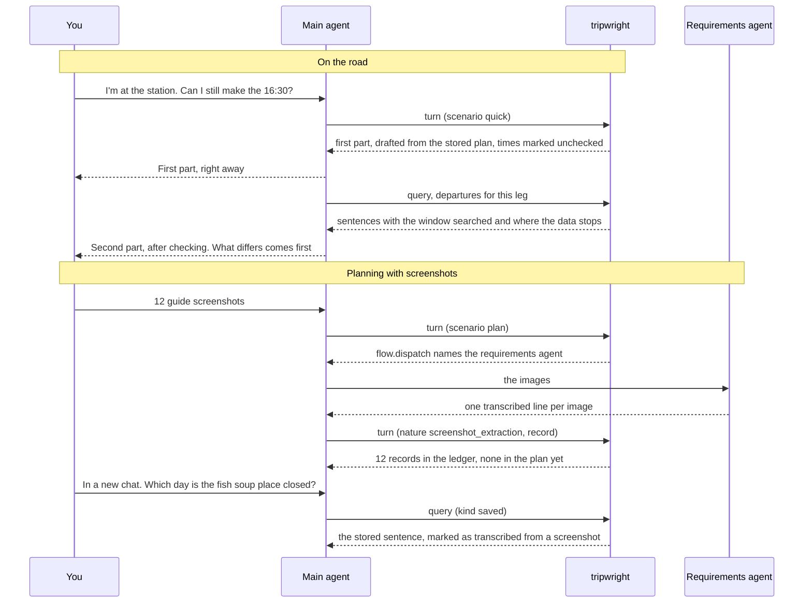

<h1 align="center"></h1>

<p align="center">An open-source trip-planning server for AI assistants: it remembers plans across chats, checks transport facts with sources, and creates shareable pages.</p>

<p align="center"><strong>English</strong> | <a href="README.zh-CN.md">简体中文</a> | <a href="https://zlxdengtianhei.github.io/tripwright/">Project page</a></p>

<p align="center"></p>
<p align="center"><sub>A real 8-day trip (Budapest, Vienna and the Salzkammergut, October 2026), as the page tripwright makes. Names are replaced with codes, and places to stay show only the district.</sub></p>

You deploy your own copy: [three steps](#get-started), or [look at an example trip first](#see-an-example). It also remembers your preferences across chats and records every change. It works with Claude, ChatGPT, Claude Code, Codex and other apps that support MCP (the Model Context Protocol, the open standard that lets AI apps call outside tools).

There is no hosted service and no signup. Each person runs their own copy, for themselves.

## What you get

- **Your own travel library, from screenshots.** Send a batch of guide screenshots at once, from Xiaohongshu or anywhere. Your assistant transcribes them, stores the places in your trip and the tips in its records, and later answers draw on them. Ask it to research something, and it records what it found with the source. When a question needs a fact that is not stored, it looks it up and records it. The screenshots themselves are not kept; their transcription is, marked as such.
- **One trip, many chats.** Your preferences, travel companions, decisions and places to see are stored once. Each new message brings back the ones that apply, in any app that is connected to your service.
- **Quick answers on the road, then checked ones.** For a quick question, your assistant first answers from the stored plan and marks what is not checked. It then checks and tells you what changed.
- **Transport facts with their limits.** Each leg comes with departures, transfers, the time window searched and where the data stops. No result means “not found”, never “no service”.
- **A record of every change.** Each accepted change records what changed, who changed it and why. A result computed on an old version cannot overwrite a newer plan. Your trips live in a Git repository that you own.
- **A trip page for your friends.** After each plan change, the service builds a day-by-day page, scans it for private data and publishes it to a public repository that you choose. This step is optional.

Your assistant's model still writes the answers. tripwright supplies the memory, the sourced facts and the record.

## How it works



Your app runs the agents; the service keeps the trip, returns what applies to each message, and names who does the next step. The three helpers are sub-agents in Claude Code and Codex. In a plain chat, one agent does their steps itself and follows the same `flow`. One of the seven MCP tools receives each message; the others look up facts, propose and commit changes, and read the plan and its history. Without a private repository, the trips stay in a local Git repository on the service's volume.

**From one sentence to a saved plan.** A change is saved only after it passes the service's checks; a refused change is never reported as done.



**Two situations.** On the road, a short question gets two answers; in a chat app, the second comes after you reply “continue”. When planning, screenshots become records you can ask about later. In both diagrams, solid arrows were run with real models on 2026-11-12 ([Testing and limits](#testing-and-limits)); dashed arrows are covered by automated tests.



## Get started

Three steps. You need a computer or server that can run Docker, or a Railway account. You do not need a GitHub account for the basic setup.

1. **Give [deploy/SETUP.md](deploy/SETUP.md) to your coding agent** (Claude Code, Codex or similar). It starts the service with Docker (three commands) or on Railway, and prints your connection address, `https://<your-host>/mcp/<key>`. This address is your only login. Anyone who has it can read and change your trips, so treat it like a password.
2. **Recommended: connect GitHub.** These are two separate repositories. A private repository keeps the full record of your trips; without it, they are kept only on the server. A public repository holds only the scanned trip pages that you share, and nothing else; public pages need it. After you connect it, every trip gets a page; you can switch off any trip. The agent runs three commands for each repository, with no restart.
3. **Add the address to your app.** Coding agents add it for you. In Claude and ChatGPT, the account owner clicks **Add** in the app's settings. Then ask: “Use tripwright: which trips are stored?”

**Or deploy on Railway in one click:** [](https://railway.com/new/template/tripwright) The template builds this repository, with a volume at `/data`, a public domain and a health check. When the deploy is ready, open the service's **Variables** tab and copy `TRIPWRIGHT_ADDRESS`: that is your connection address. Then go on with steps 2 and 3. Details: [deploy/RAILWAY.md](deploy/RAILWAY.md).

The agent asks you only for what only you can do: sign in to Railway, type a system password, pay, or click **Add**.

## Connect your assistant

| Where you use it | How it connects | Replies | How we tested it |
| --- | --- | --- | --- |
| Claude Code | `claude mcp add --transport http tripwright <address>` | Two messages: the first part, then the checked part | Claude Code with Claude Sonnet 5.5 and the helper roles |
| Claude (web, desktop, mobile) | Settings, add a custom connector, sign-in “none” | The first part, then the checked part after you reply | Claude Sonnet 5.5 and Opus 5.5 through the Claude API's MCP connector, which connects from Anthropic's cloud as a custom connector does |
| ChatGPT | Web only. Business, Enterprise or Edu to use all tools; Pro is read-only | The same; or one message, see below | Set up as OpenAI documents; GPT models tested through Codex |
| Codex | `codex mcp add tripwright --url <address>` | Not measured | Codex CLI with a GPT model: read the trip and changed the plan |
| Cursor and other MCP clients | Streamable HTTP with the same address | Depends on the client | Set up as each client documents |

This is a default you can change. Set `TRIPWRIGHT_REPLY_FLOW=one` when you deploy to get both parts in one reply (see [deploy/README.md](deploy/README.md)); that suits GPT models, while Claude often leaves the first part out. Only quick questions on the road have two parts. Account limits, the steps for each app and problems are in [docs/CONNECT.md](docs/CONNECT.md) and [deploy/CLIENTS.md](deploy/CLIENTS.md).

## Getting the best results

**Two ways to use it.** On the road, ask short questions (“I'm at the station, when is the next train?”): a first answer from your stored plan comes within seconds, then the checked one. When planning, send requirements and screenshots: they are recorded before the plan changes, even when the change is held back, and the requirements agent links them to what you already decided; the changed plan is checked before it is saved.

**Use an app that can run sub-agents.** In Claude Code and Codex the service names the helper each step needs: a requirements agent records new requirements and screenshots and links them to your earlier decisions; a researcher checks each fact, and ticket prices and discounts when tickets are still to buy; a verifier checks a changed plan before it is saved. The service updates the website itself. On quick questions on the road the main agent usually looks the fact up itself: in Claude Code with Sonnet it answered in about 15–20 seconds, correctly, in 3 of 3 runs.

**A plain chat works too.** In ChatGPT or Claude chat one agent does everything: the checked answer comes after you reply “continue”, and the service sends back the requirements that apply with every message.

**Many screenshots.** Both apps take about 20 images per message (ChatGPT: 20 files per message, 20 MB per image, 3 uploads per day on the free plan; Claude: 20 images per message, 10 MB and 8000 × 8000 pixels per image). Send them in batches of up to 20. Neither app's help pages list ZIP among the formats a chat accepts, so do not zip them for a chat; to make them smaller, save smaller images or crop the empty parts, as long as each stays within the limit. For more, save them to one folder (on iPhone, in Files) and give the folder to Claude Code or Codex.

## See an example

[examples/trip-2026-10-central-europe.yaml](examples/trip-2026-10-central-europe.yaml) is a real 8-day trip, put together from a page its owner already published, plus a trip log of what the owner typed on the road. To build its ten pages on your computer (Python 3.11+ and [uv](https://docs.astral.sh/uv/)):

```bash
uv sync --extra dev
uv run python -m tripwright.site.example examples/trip-2026-10-central-europe.yaml out
```

Open `out/index.html`. The page has an EN / 中文 switch. `out/log.html` is the trip log: what the traveler typed on the road, how it was handled then, and what tripwright does with such a message now. The [project page](https://zlxdengtianhei.github.io/tripwright/) shows more. To see the program's output for a made-up trip, run `uv run tripwright demo`.

## Testing and limits

- **Claude through the API (2026-11-12).** Anthropic's cloud connected to a test deployment through the Claude API's MCP connector and ran ten conversations, in English and Chinese: first use; a question on the road; moving a dinner and noting an allergy; saving three screenshots, then finding them again in a new chat; a planning request with a new requirement. Claude Sonnet 5.5 passed 45 of 48 runs and Claude Opus 5.5 passed 6 of 6. Each run started from a fresh service with a fictional trip. In both Opus planning runs, Claude recorded the requirement and then asked before saving, because the plan left no time to get from dinner to the walk. In 2 of 12 Sonnet planning runs, Claude changed the plan without first recording the request as a requirement; the message itself is still stored.
- **Claude Code with the helper roles (2026-11-12, Claude Sonnet 5.5).** Twelve screenshots sent at once: the requirements agent stored all 12, and all 12 were found again, in 3 of 3 runs. Plan changes: the new requirement was recorded before the plan in 6 of 6 runs, and a changed plan was saved only after the verifier had checked it. On a one-line change the main agent sometimes records the requirement itself instead of sending it to the requirements agent (2 of 3 runs); it is recorded correctly either way.
- **A known case.** When the assistant passes on a question that names a stored place as your location (“can I get into the airport?”), the quick first reply says you are at that place instead of where the plan has you at that time.
- **Also tested:** the Codex CLI with a GPT model; GPT, GLM and Kimi models in a test chat host; the MCP conformance checks; about 1,600 automated tests.
- **Deployment.** From the first Docker command to a ready service took about 13 seconds when a low-cost model followed SETUP.md alone. On Railway, a real account was ready 59 seconds after upload. Connecting a private GitHub repository with a deploy key, and upgrading an older installation, were done on a real server.
- **Trip pages.** The scan replaces names with codes and shows places to stay by district only. If it finds something like a booking number, it publishes nothing for that build. After you connect a public repository, every trip is published by default; set `off: true` in the trip's `share.yaml` to stop one.
- **Transport data** comes from [Transitous](https://transitous.org/sources/), [Open-Meteo](https://open-meteo.com/) and [Nominatim / OpenStreetMap](https://www.openstreetmap.org/copyright). It is mostly timetables, not live data. Coverage is not worldwide, and the end of timetable data is detected only for Austria. By default the service sends at most 720 Transitous route requests per rolling 24 hours. Details: [docs/DATA_SOURCES.md](docs/DATA_SOURCES.md).
- **Privacy.** Your trips and messages are stored in your deployment. Your Git host, your client app and each data source handle data under their own terms. Logs may contain message text; limit who can read them. Never put unreviewed personal trips or keys in a public repository.

## Documentation

- [deploy/SETUP.md](deploy/SETUP.md): the runbook for your coding agent. [deploy/README.md](deploy/README.md): settings and Docker reference. [deploy/RAILWAY.md](deploy/RAILWAY.md): Railway.
- [deploy/CLIENTS.md](deploy/CLIENTS.md) and [docs/CONNECT.md](docs/CONNECT.md): connect each app; local mode without a service.
- [docs/FORMAT.md](docs/FORMAT.md): the trip repository format. [docs/DATA_SOURCES.md](docs/DATA_SOURCES.md): data sources.
- Tests: `uv run pytest -q`.

## License

The code is under the [MIT license](LICENSE). Upstream data and service terms apply separately; the MIT license gives no commercial rights to the Transitous public API.
