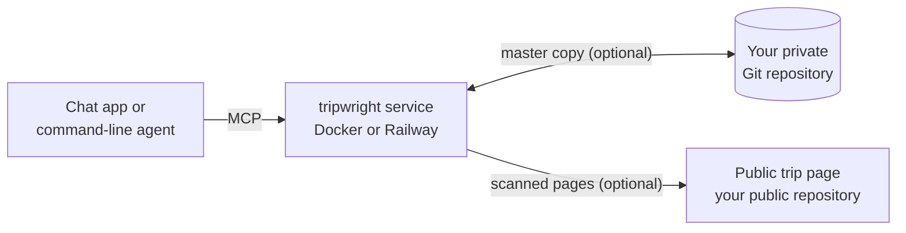

<h1 align="center"></h1>

<p align="center">An open-source trip-planning server for AI assistants: it remembers plans across chats, checks transport facts with sources, and creates shareable pages.</p>

<p align="center"><strong>English</strong> | <a href="README.zh-CN.md">简体中文</a> | <a href="https://zlxdengtianhei.github.io/tripwright/">Project page</a></p>

<p align="center"></p>
<p align="center"><sub>A real 8-day trip (Budapest, Vienna and the Salzkammergut, October 2026), as the page tripwright makes. Names are replaced with codes, and places to stay show only the district.</sub></p>

You deploy your own copy. It also remembers your preferences across chats and records every change. It works with Claude, ChatGPT, Claude Code, Codex and other apps that support MCP (the Model Context Protocol, the open standard that lets AI apps call outside tools).

There is no hosted service and no signup. Each person runs their own copy, for themselves.

## What you get

- **One trip, many chats.** Your preferences, travel companions, decisions and places to see are stored once. Each new message brings back the ones that apply, in any app that is connected to your service.
- **Quick answers on the road, then checked ones.** For a quick question, your assistant first answers from the stored plan and marks what is not checked. It then checks and tells you what changed.
- **Transport facts with their limits.** Each leg comes with departures, transfers, the time window searched and where the data stops. No result means “not found”, never “no service”.
- **A record of every change.** Each accepted change records what changed, who changed it and why. A result computed on an old version cannot overwrite a newer plan. Your trips live in a Git repository that you own.
- **A trip page for your friends.** After each plan change, the service builds a day-by-day page, scans it for private data and publishes it to a public repository that you choose. This step is optional.

Your assistant's model still writes the answers. tripwright supplies the memory, the sourced facts and the record.

## How it works



The service has seven MCP tools. One of them receives each message and returns what applies now; the others look up facts, propose and commit changes, and read the plan and its history. Without a private repository, the trips stay in a local Git repository on the service's volume.

## Get started

Three steps. You need a computer or server that can run Docker, or a Railway account. You do not need a GitHub account for the basic setup.

1. **Give [deploy/SETUP.md](deploy/SETUP.md) to your coding agent** (Claude Code, Codex or similar). It starts the service with Docker (three commands) or on Railway, and prints your connection address, `https://<your-host>/mcp/<key>`. This address is your only login. Anyone who has it can read and change your trips, so treat it like a password.
2. **Optional: connect GitHub.** A private repository keeps the master copy of your trips, and a public repository holds the trip pages. The agent runs three commands for each repository, with no restart.
3. **Add the address to your app.** Coding agents add it for you. In Claude and ChatGPT, the account owner clicks **Add** in the app's settings. Then ask: “Use tripwright: which trips are stored?”

The agent asks you only for what only you can do: sign in to Railway, type a system password, pay, or click **Add**.

## Connect your assistant

| Where you use it | How it connects | Replies | Checked by us |
| --- | --- | --- | --- |
| Claude Code | `claude mcp add --transport http tripwright <address>` | Two messages: the first part, then the checked part | Yes, connected and used |
| Claude (web, desktop, mobile) | Settings, add a custom connector, sign-in “none” | The first part, then the checked part after you reply | No real app connection yet |
| ChatGPT | Web only. Business, Enterprise or Edu to use all tools; Pro is read-only | The same; or one message, see below | No real app connection yet |
| Codex | `codex mcp add tripwright --url <address>` | Not measured | Command taken from the docs |
| Cursor and other MCP clients | Streamable HTTP with the same address | Depends on the client | No |

This is a default you can change. Set `TRIPWRIGHT_REPLY_FLOW=one` when you deploy to get both parts in one reply (see [deploy/README.md](deploy/README.md)); that suits GPT models, while Claude often leaves the first part out. Only quick questions on the road have two parts. Account limits, the steps for each app and problems are in [docs/CONNECT.md](docs/CONNECT.md) and [deploy/CLIENTS.md](deploy/CLIENTS.md).

## See an example

[examples/trip-2026-10-central-europe.yaml](examples/trip-2026-10-central-europe.yaml) is a real 8-day trip, put together from a page its owner already published. To build its nine pages on your computer (Python 3.11+ and [uv](https://docs.astral.sh/uv/)):

```bash
uv sync --extra dev
uv run python -m tripwright.site.example examples/trip-2026-10-central-europe.yaml out
```

Open `out/index.html`. The page has an EN / 中文 switch. The [project page](https://zlxdengtianhei.github.io/tripwright/) shows more. To see the program's output for a made-up trip, run `uv run tripwright demo`.

## Status and limits

- **Real apps are untested.** The ChatGPT and Claude apps have never been connected. We tested with scripts that simulate a chat host, and with Claude Code.
- **Answer quality is still being evaluated.** The service gives facts and instructions, but the assistant can still combine correct facts wrongly, such as a wrong venue or no walking time to the platform. The service cannot stop this.
- **Deployment.** From the first Docker command to a ready service took about 13 seconds in a run where a low-cost model followed SETUP.md alone. On Railway, a real account was ready 59 seconds after upload. Connecting a private GitHub repository was tested only against a local bare repository; a real GitHub deploy key is not tested yet.
- **Trip pages.** The scan replaces names with codes and shows places to stay by district only. If it finds something like a booking number, it publishes nothing for that build. After you connect a public repository, every trip is published by default; set `off: true` in the trip's `share.yaml` to stop one. This was tested only against a local bare repository, not on real GitHub Pages.
- **Transport data** comes from [Transitous](https://transitous.org/sources/), [Open-Meteo](https://open-meteo.com/) and [Nominatim / OpenStreetMap](https://www.openstreetmap.org/copyright). It is mostly timetables, not live data. Coverage is not worldwide, and the end of timetable data is detected only for Austria. By default the service sends at most 720 Transitous route requests per rolling 24 hours. Details: [docs/DATA_SOURCES.md](docs/DATA_SOURCES.md).
- **Privacy.** Your trips and messages are stored in your deployment. Your Git host, your client app and each data source handle data under their own terms. Logs may still contain message text; limit who can read them. Never put unreviewed personal trips or keys in a public repository.

## Documentation

- [deploy/SETUP.md](deploy/SETUP.md): the runbook for your coding agent. [deploy/README.md](deploy/README.md): settings and Docker reference. [deploy/RAILWAY.md](deploy/RAILWAY.md): Railway.
- [deploy/CLIENTS.md](deploy/CLIENTS.md) and [docs/CONNECT.md](docs/CONNECT.md): connect each app; local mode without a service.
- [docs/FORMAT.md](docs/FORMAT.md): the trip repository format. [docs/DATA_SOURCES.md](docs/DATA_SOURCES.md): data sources.
- Tests: `uv run pytest -q`.

## License

The code is under the [MIT license](LICENSE). Upstream data and service terms apply separately; the MIT license gives no commercial rights to the Transitous public API.
