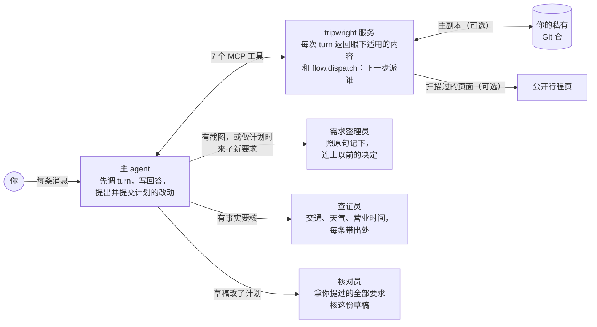
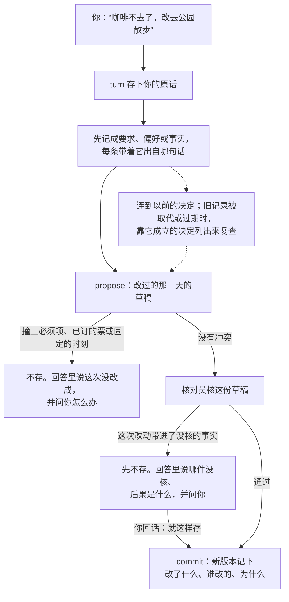
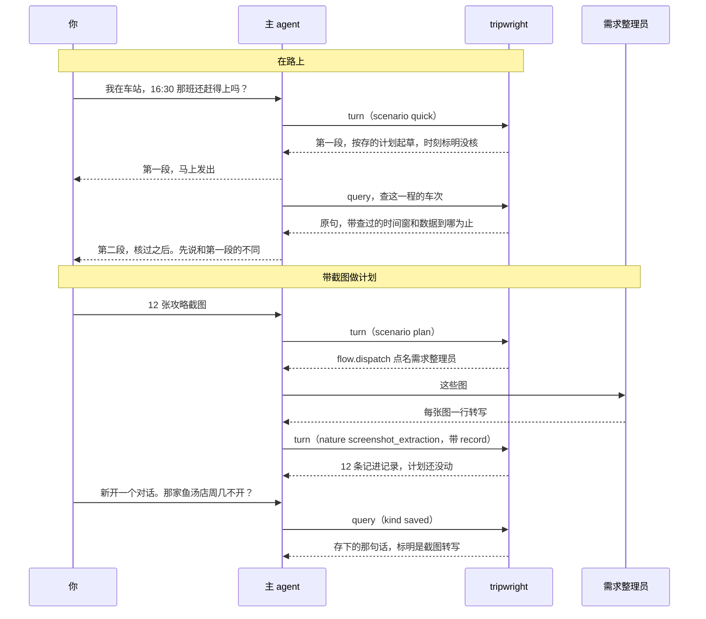

<h1 align="center"></h1>

<p align="center">tripwright 是给 AI 助手用的开源旅行规划服务：跨对话记住行程，核查交通事实并附来源，生成可分享的网页。</p>

<p align="center"><a href="README.md">English</a> | <strong>简体中文</strong> | <a href="https://zlxdengtianhei.github.io/tripwright/">项目主页</a></p>

<p align="center"></p>
<p align="center"><sub>一趟真实的 8 天行程（布达佩斯、维也纳、萨尔茨卡默古特，2026 年 10 月）和 tripwright 生成的中文页面。人名已换成代号，住处只写到城区。</sub></p>

服务由你自己部署一份：[三步开始用](#开始用)，也可以[先看一趟示例行程](#看示例)。它也会跨对话记住你的偏好，记下每一次改动。它通过 MCP（模型上下文协议，让 AI App 调用外部工具的开放标准）接进 Claude、ChatGPT、Claude Code、Codex 等支持 MCP 的客户端。

没有公共服务，也不开放注册：每人自己部署一份，只给自己用。

## 能给到什么

- **截图攒成你自己的资料库。** 小红书或别处搜到的攻略，截图一次全发过来。助手转写成文字，把里面的地方存进行程、把要点记进记录，以后的建议都从这里出。也可以让它去调研，查到的连同出处记下来；问到没存的事实，它会去查，查到后也记下。截图本身不存，存的是转写的文字，并标明“截图转写”。
- **一趟行程，多个对话共用。** 你的偏好、同行人、决定和想去的地方只存一份。每收到一条新消息，就带出其中适用的部分；接在同一个服务上的任何 App 都能用。
- **路上的快问：先答，再核。** 遇到快问，助手先按存的计划回答，并标出还没核的地方；核完再说哪里变了。
- **交通事实写明范围。** 每一程给出车次、换乘、查询的时间窗和数据覆盖到哪里为止。没查到只说“没查到”，不说“没有车”。
- **每次改动都有记录。** 每次接受的改动都记下改了什么、谁改的、为什么。在旧版本上算出的结果，不能覆盖新计划。行程存在你自己的 Git 仓里。
- **给朋友看的行程页。** 每次计划有改动，服务就生成逐天的网页，先扫一遍私密信息，再发到你指定的公开仓。这一步可以不做。

回答仍由你的助手所用的模型来写。tripwright 提供记忆、带来源的事实和改动记录。

## 它怎样工作



几个 agent 跑在你的 App 里；服务保管行程，每条消息返回眼下适用的内容，并点名下一步交给谁。三个帮手在 Claude Code 和 Codex 里是子代理。在普通聊天里，一个 agent 自己做这几步，照的是同一份 `flow`。7 个 MCP 工具里，一个接收每条消息；其余的查事实、提出和提交改动、读计划与历史。不连私有仓时，行程存在服务数据卷里的本地 Git 仓中。

**从一句话到存下的计划。** 改动过了服务的检查才会存下；被拒绝的改动，不会说成已经改好。改动带进了没人核过的外部事实（营业时间、时刻表、天气、票、定死的时刻），要等你的下一条消息到了才存。



**两个场景。** 在路上，一句快问得到两段回答；在聊天 App 里，第二段在你回一句“继续”之后来。做计划时，截图变成以后问得到的记录。两张图里，实线在 2026-11-12 用真实模型跑过（见[测试与限制](#测试与限制)）；虚线由自动测试覆盖。



## 开始用

三步。你需要一台能跑 Docker 的电脑或服务器，或者一个 Railway 账号。基本部署不需要 GitHub 账号。

1. **把 [deploy/SETUP.md](deploy/SETUP.md) 交给你的编码 agent**（Claude Code、Codex 等）。它用 Docker（三条命令）或 Railway 起服务，并给你连接地址 `https://<你的域名>/mcp/<密钥>`。这个地址是唯一的登录凭据：拿到它的人能读写你的行程，要像密码一样保管。
2. **推荐：连 GitHub。** 这是两个分开的仓。私有仓存你行程的全部记录；不连的话，行程只存在服务器上。公开仓只放扫描过、给别人看的行程页，别的不放；要公开页就得连它。连上公开仓后，每趟行程默认都有一页，哪一趟不想公开可以单独关掉。每个仓 agent 跑三条命令，不用重启，命令在 SETUP.md 里。
3. **把地址加进你的 App。** 编码 agent 会替你加。在 Claude 和 ChatGPT 里，由账号主人在 App 设置里点 **添加**。然后问一句：“用 tripwright：存了哪些行程？”

**也可以在 Railway 上一键部署：** [](https://railway.com/new/template/tripwright)模板会构建这个仓，配好挂在 `/data` 的数据卷、公网域名和健康检查。部署就绪后，打开服务的 **Variables** 页，复制 `TRIPWRIGHT_ADDRESS`，它就是你的连接地址。然后接着做第 2、3 步。详见 [deploy/RAILWAY.md](deploy/RAILWAY.md)。

agent 只会请你做只有你能做的事：登录 Railway、输入系统密码、付款、点 **添加**。

## 连接你的助手

| 你在哪用 | 怎样连 | 回答 | 我们怎样测的 |
| --- | --- | --- | --- |
| Claude Code | `claude mcp add --transport http tripwright <地址>` | 两条消息：先发第一段，再发核过的第二段 | Claude Code 加 Claude Sonnet 5.5，连同几个帮手角色 |
| Claude（网页、桌面、手机） | 设置里加自定义连接器，认证选“无” | 你回一句“继续”后发核过的第二段。网页上测的那 1 次，第一条回复里已经带着查到的结果 | Claude 网页（Ultra 套餐，Fable 5.2，1 次对话）；Claude Sonnet 5.5 与 Opus 5.5 经 Claude API 的 MCP 连接器：和自定义连接器一样，由 Anthropic 的云端来连服务 |
| ChatGPT | 只能在网页版加：在“插件”里添加自定义 MCP 服务器。免费版加成了；每个会写入的工具运行前 ChatGPT 都问一次 | 先发第一段，你回一句后发核过的第二段；也可以改成一条，见下 | ChatGPT 网页（免费版，1 次对话）；GPT 模型经 Codex 测过 |
| Codex | `codex mcp add tripwright --url <地址>` | 没量过 | Codex 命令行加 GPT 模型：读过行程、改过计划 |
| Cursor 等其他 MCP 客户端 | 用同一个地址，走 Streamable HTTP | 看客户端 | 按各家官方文档配置 |

这是可以改的默认。部署时设 `TRIPWRIGHT_REPLY_FLOW=one`，两段就放进同一条回复（见 [deploy/README.md](deploy/README.md)）；这适合 GPT 一类模型，Claude 常会漏掉第一段。只有路上的快问才分两段。各家的账号限制、每个 App 的步骤和连接问题，见 [docs/CONNECT.md](docs/CONNECT.md) 与 [deploy/CLIENTS.md](deploy/CLIENTS.md)。

## 怎样用效果最好

**两种用法。** 在路上，随口问（“我在车站，下一班车几点”）：几秒内先给出按存好的计划答的第一段，再给核过的第二段。做计划时，把要求和截图发过来：改计划之前先记下来（计划没改成也不丢），需求整理员把它们连上你以前定过的事；改过的计划存之前核一遍。改动带进了没核的事实时（晚饭挪到一个没人查过那家店开不开门的钟点），服务先不存，等你的下一条消息到了才放行：助手可以先告诉你，你同意了再存。计划自己没填全的地方（两处之间路上要多久没人给），在回答里说明，不挡存。

**用能派子代理的 App。** 在 Claude Code 和 Codex 里，服务每一步点名该派哪个帮手：需求整理员转写截图、把新要求整理成记录并连上你以前的决定，交主 agent 存下；查证员核每件事实，有还没买的票时另查票价与优惠；核对员在改过的计划存下之前核一遍。网站由服务自己更新。路上的快问，主 agent 通常自己查：Claude Code 用 Sonnet 测的 3 次，都在约 15—20 秒内答完，答得都对。

**普通聊天也能用。** 在 ChatGPT 或 Claude 的聊天里，一个 agent 什么都做：核过的回答在你回一句“继续”之后来；服务每条消息都会把眼下适用的要求带回去。

**截图很多时。** 两家每条消息都是约 20 张（ChatGPT：每条 20 个文件、每张 20 MB，免费版每天 3 次上传；Claude：每条 20 张、每张 10 MB、最大 8000 × 8000 像素）。每次 20 张以内分批发。两家聊天能收的格式里都没有 zip，所以别压缩成 zip 再发；要缩小体积，就把图片存小一点、截图时少截空白，每张在限额内就行。更多的话，在 iPhone 的“文件”里存进一个文件夹，交给 Claude Code 或 Codex 读。

## 看示例

[examples/trip-2026-10-central-europe.yaml](examples/trip-2026-10-central-europe.yaml) 是一趟真实的 8 天行程，根据主人已经公开的页面整理而成，另加一页旅行实录（主人在路上说过的话）。在自己电脑上生成它的 10 个页面（需要 Python 3.11+ 和 [uv](https://docs.astral.sh/uv/)）：

```bash
uv sync --extra dev
uv run python -m tripwright.site.example examples/trip-2026-10-central-europe.yaml out
```

打开 `out/index.html` 即可，页面上有 EN / 中文 切换。`out/log.html` 是旅行实录：我在路上说了什么、当时怎样处理、tripwright 现在怎样对待这类话。更多展示见[项目主页](https://zlxdengtianhei.github.io/tripwright/)。想看程序对一趟虚构行程的输出，运行 `uv run tripwright demo`。

## 测试与限制

- **经 API 用 Claude 测（2026-11-12）。** Anthropic 的云端经 Claude API 的 MCP 连接器连一份测试部署，用中英文跑十种对话：第一次用；路上的问题；挪晚饭并记下过敏；存三张截图，再在新对话里找回；做计划时提一条新要求。Claude Sonnet 5.5 过了 48 次里的 45 次，Claude Opus 5.5 6 次全过。每次都从一份新起的服务和一趟虚构行程开始。Opus 做计划的 2 次都先记下要求，再停下来问用户，因为计划里晚饭到散步之间没留路上的时间。Sonnet 做计划的 12 次里有 2 次改了计划，却没先把这条请求记成要求；消息本身照样存着。
- **在 Claude Code 里连同帮手角色测（2026-11-12，Claude Sonnet 5.5）。** 一次发 12 张截图：3 次都由需求整理员读图转写，主 agent 照它的转写把 12 张都存下，12 张都找得回。改计划：新要求 6 次都在改计划之前记下；改过的计划都在核对员核过之后才存。一句话的小改动，主 agent 有时自己记下要求，不交需求整理员（3 次里 2 次）；两种做法都记对了。
- **在 Claude 网页和 ChatGPT 网页上测（2026-11-12，各 1 次对话，中文，虚构行程）。** 两家都读出了存着的行程，路上的问题都从服务取答案、没用网页搜索，都挪了晚饭、记下了过敏。Claude（Ultra 套餐，Fable 5.2）：路上那一问的第一条回复里已经带着查到的结果，也没请你回话；标着“核过之后”的那一段在回“继续”之后来。ChatGPT（免费版）：回答分成了两段；每个会写入的工具运行前它都问一次。两家都是先把挪过的晚饭存下，存完才说新钟点那家店开不开门没人核过。现在服务会拒绝这样存：提出改动之后，`turn` 又收到一条文字不同的新消息，才放行。服务能查的只有这一条：它读不到助手对你说了什么，也判不了那条消息是不是同意。它只为外部事实等；路上时间没填、或一条它没法检验的要求，交给助手在回答里说，不等就存。这一条是 2026-11-13 在测试用的宿主里跑的，还没回到两个 App 里重测：9 次对话（GPT、GLM、Claude Fable 5.2 各 3 次）都没有在用户的下一条消息之前存下；回了“可以，照这样存”之后 8 次存下，另 1 次没存：那份草稿被服务的另一项检查拒了（记下的过敏要求怎样用到这顿饭上）。
- **已知的一种情况。** 助手把一句带着存过的地名的问话（“机场能不能进去”）当成你的所在地传过来时，路上快问的第一段会说你在那个地方，而不是计划里你这时在的地方。
- **另外测过：** Codex 命令行加 GPT 模型；在测试用的聊天宿主里测 GPT、GLM 和 Kimi；MCP 官方的一致性检查；约 1600 个自动测试。
- **部署。** 一次测试里，由低成本模型只照 SETUP.md 操作，从第一条 Docker 命令到服务就绪用了约 13 秒。在 Railway 上，用真账号跑过，上传后 59 秒就绪。用部署钥匙连私有 GitHub 仓、把旧版装好的服务升级到新版，都在真实服务器上做过。
- **行程页。** 扫描会把人名换成代号，住处只写到城区；扫到订单号之类的内容，这一版就整版不发。连上公开仓后，默认每趟行程都发；要停发某一趟，在这趟行程的 `share.yaml` 里写 `off: true`。
- **交通数据** 来自 [Transitous](https://transitous.org/sources/)、[Open-Meteo](https://open-meteo.com/) 和 [Nominatim / OpenStreetMap](https://www.openstreetmap.org/copyright)，主要是时刻表，不是实时数据。覆盖范围不是全球；时刻表数据何时到期，只有奥地利能识别。服务默认每滚动 24 小时最多向 Transitous 发 720 次路线请求。详见 [docs/DATA_SOURCES.md](docs/DATA_SOURCES.md)。
- **隐私。** 你的行程和消息存在你的部署里。Git 托管方、客户端 App 和各数据来源，按各自的条款处理数据。日志里可能留有消息正文，要限制谁能读日志。不要把没审过的个人行程或密钥放进公开仓。

## 文档索引

- [deploy/SETUP.md](deploy/SETUP.md)：交给编码 agent 的部署步骤。[deploy/README.md](deploy/README.md)：配置与 Docker 参考。[deploy/RAILWAY.md](deploy/RAILWAY.md)：Railway。
- [deploy/CLIENTS.md](deploy/CLIENTS.md) 与 [docs/CONNECT.md](docs/CONNECT.md)：各 App 的连接步骤；不起服务的本机模式。
- [docs/FORMAT.md](docs/FORMAT.md)：行程仓的格式。[docs/DATA_SOURCES.md](docs/DATA_SOURCES.md)：数据来源。
- 测试：`uv run pytest -q`。

## 许可

代码采用 [MIT 许可](LICENSE)。上游数据和服务条款另行适用；MIT 许可不授予 Transitous 公共 API 的商业使用权。
