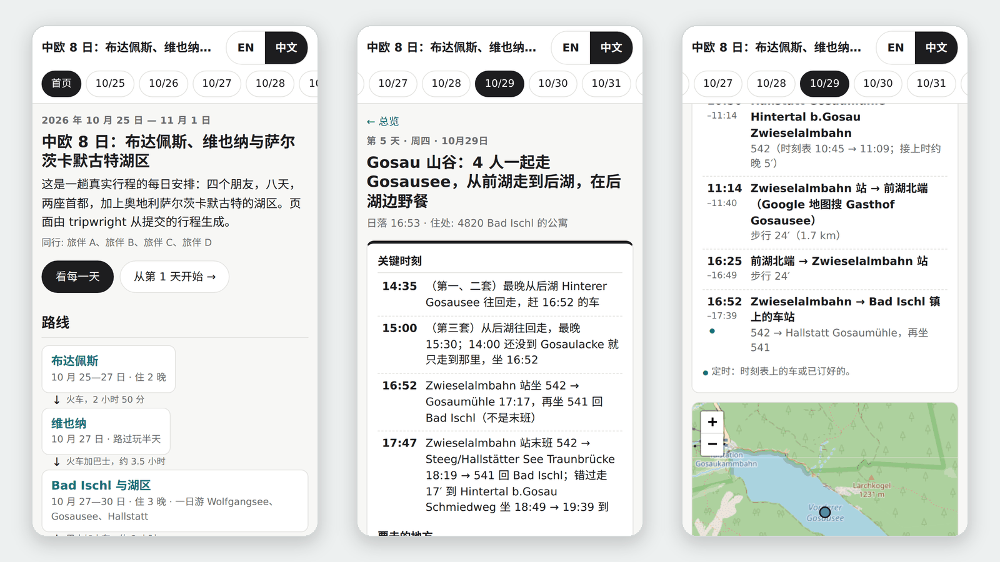
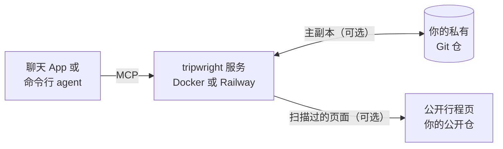

<h1 align="center"></h1>

<p align="center">tripwright 是给 AI 助手用的开源旅行规划服务：跨对话记住行程，核查交通事实并附来源，生成可分享的网页。</p>

<p align="center"><a href="README.md">English</a> | <strong>简体中文</strong> | <a href="https://zlxdengtianhei.github.io/tripwright/">项目主页</a></p>

<p align="center"></p>
<p align="center"><sub>一趟真实的 8 天行程（布达佩斯、维也纳、萨尔茨卡默古特，2026 年 10 月）和 tripwright 生成的中文页面。人名已换成代号，住处只写到城区。</sub></p>

服务由你自己部署一份：[三步开始用](#开始用)，也可以[先看一趟示例行程](#看示例)。它也会跨对话记住你的偏好，记下每一次改动。它通过 MCP（模型上下文协议，让 AI App 调用外部工具的开放标准）接进 Claude、ChatGPT、Claude Code、Codex 等支持 MCP 的客户端。

没有公共服务，也不开放注册：每人自己部署一份，只给自己用。

## 能给到什么

- **一趟行程，多个对话共用。** 你的偏好、同行人、决定和想去的地方只存一份。每收到一条新消息，就带出其中适用的部分；接在同一个服务上的任何 App 都能用。
- **路上的快问：先答，再核。** 遇到快问，助手先按存的计划回答，并标出还没核的地方；核完再说哪里变了。
- **交通事实写明范围。** 每一程给出车次、换乘、查询的时间窗和数据覆盖到哪里为止。没查到只说“没查到”，不说“没有车”。
- **每次改动都有记录。** 每次接受的改动都记下改了什么、谁改的、为什么。在旧版本上算出的结果，不能覆盖新计划。行程存在你自己的 Git 仓里。
- **给朋友看的行程页。** 每次计划有改动，服务就生成逐天的网页，先扫一遍私密信息，再发到你指定的公开仓。这一步可以不做。

回答仍由你的助手所用的模型来写。tripwright 提供记忆、带来源的事实和改动记录。

## 它怎样工作



服务提供 7 个 MCP 工具：一个接收每条消息、返回眼下适用的内容；其余的查事实、提交和确认改动、读计划与历史。不连私有仓时，行程存在服务数据卷里的本地 Git 仓中。

## 开始用

三步。你需要一台能跑 Docker 的电脑或服务器，或者一个 Railway 账号。基本部署不需要 GitHub 账号。

1. **把 [deploy/SETUP.md](deploy/SETUP.md) 交给你的编码 agent**（Claude Code、Codex 等）。它用 Docker（三条命令）或 Railway 起服务，并给你连接地址 `https://<你的域名>/mcp/<密钥>`。这个地址是唯一的登录凭据：拿到它的人能读写你的行程，要像密码一样保管。
2. **推荐：连 GitHub。** 这是两个分开的仓。私有仓存你行程的全部记录；不连的话，行程只存在服务器上。公开仓只放扫描过、给别人看的行程页，别的不放；要公开页就得连它。连上公开仓后，每趟行程默认都有一页，哪一趟不想公开可以单独关掉。每个仓 agent 跑三条命令，不用重启，命令在 SETUP.md 里。
3. **把地址加进你的 App。** 编码 agent 会替你加。在 Claude 和 ChatGPT 里，由账号主人在 App 设置里点 **添加**。然后问一句：“用 tripwright：存了哪些行程？”

agent 只会请你做只有你能做的事：登录 Railway、输入系统密码、付款、点 **添加**。

## 连接你的助手

| 你在哪用 | 怎样连 | 回答 | 我们验过吗 |
| --- | --- | --- | --- |
| Claude Code | `claude mcp add --transport http tripwright <地址>` | 两条消息：先发第一段，再发核过的第二段 | 验过，已连通并用过 |
| Claude（网页、桌面、手机） | 设置里加自定义连接器，认证选“无” | 先发第一段，你回一句后发核过的第二段 | 还没连过真实 App |
| ChatGPT | 只能在网页版加。用全部工具要 Business、Enterprise 或 Edu；Pro 只读 | 同上；也可以改成一条，见下 | 还没连过真实 App |
| Codex | `codex mcp add tripwright --url <地址>` | 没测 | 命令取自官方文档 |
| Cursor 等其他 MCP 客户端 | 用同一个地址，走 Streamable HTTP | 看客户端 | 没验 |

这是可以改的默认。部署时设 `TRIPWRIGHT_REPLY_FLOW=one`，两段就放进同一条回复（见 [deploy/README.md](deploy/README.md)）；这适合 GPT 一类模型，Claude 常会漏掉第一段。只有路上的快问才分两段。各家的账号限制、每个 App 的步骤和连接问题，见 [docs/CONNECT.md](docs/CONNECT.md) 与 [deploy/CLIENTS.md](deploy/CLIENTS.md)。

## 看示例

[examples/trip-2026-10-central-europe.yaml](examples/trip-2026-10-central-europe.yaml) 是一趟真实的 8 天行程，根据主人已经公开的页面整理而成。在自己电脑上生成它的 9 个页面（需要 Python 3.11+ 和 [uv](https://docs.astral.sh/uv/)）：

```bash
uv sync --extra dev
uv run python -m tripwright.site.example examples/trip-2026-10-central-europe.yaml out
```

打开 `out/index.html` 即可，页面上有 EN / 中文 切换。更多展示见[项目主页](https://zlxdengtianhei.github.io/tripwright/)。想看程序对一趟虚构行程的输出，运行 `uv run tripwright demo`。

## 现在的状态与没做到的

- **真实 App 没验过。** ChatGPT 和 Claude 的 App 一次都没连过。我们用的是模拟聊天宿主的脚本，以及 Claude Code。
- **回答质量还在评测中。** 服务给出事实和指示，但助手仍可能把对的事实组合错，例如说错场馆，或没算走到站台的时间。服务拦不住这一点。
- **部署。** 一次测试里，由低成本模型只照 SETUP.md 操作，从第一条 Docker 命令到服务就绪用了约 13 秒。在 Railway 上，用真账号跑过，上传后 59 秒就绪。连私有 GitHub 仓只对本机的裸仓验过；真实的 GitHub 部署钥匙还没验。
- **行程页。** 扫描会把人名换成代号，住处只写到城区；扫到订单号之类的内容，这一版就整版不发。连上公开仓后，默认每趟行程都发；要停发某一趟，在这趟行程的 `share.yaml` 里写 `off: true`。只对本机的裸仓验过，没在真实的 GitHub Pages 上验过。
- **交通数据** 来自 [Transitous](https://transitous.org/sources/)、[Open-Meteo](https://open-meteo.com/) 和 [Nominatim / OpenStreetMap](https://www.openstreetmap.org/copyright)，主要是时刻表，不是实时数据。覆盖范围不是全球；时刻表数据何时到期，只有奥地利能识别。服务默认每滚动 24 小时最多向 Transitous 发 720 次路线请求。详见 [docs/DATA_SOURCES.md](docs/DATA_SOURCES.md)。
- **隐私。** 你的行程和消息存在你的部署里。Git 托管方、客户端 App 和各数据来源，按各自的条款处理数据。日志里仍可能留有消息正文，要限制谁能读日志。不要把没审过的个人行程或密钥放进公开仓。

## 文档索引

- [deploy/SETUP.md](deploy/SETUP.md)：交给编码 agent 的部署步骤。[deploy/README.md](deploy/README.md)：配置与 Docker 参考。[deploy/RAILWAY.md](deploy/RAILWAY.md)：Railway。
- [deploy/CLIENTS.md](deploy/CLIENTS.md) 与 [docs/CONNECT.md](docs/CONNECT.md)：各 App 的连接步骤；不起服务的本机模式。
- [docs/FORMAT.md](docs/FORMAT.md)：行程仓的格式。[docs/DATA_SOURCES.md](docs/DATA_SOURCES.md)：数据来源。
- 测试：`uv run pytest -q`。

## 许可

代码采用 [MIT 许可](LICENSE)。上游数据和服务条款另行适用；MIT 许可不授予 Transitous 公共 API 的商业使用权。
